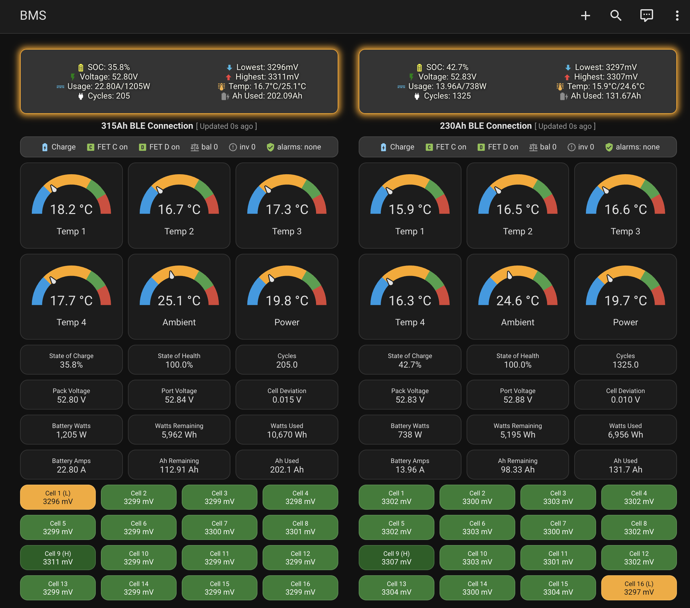

# Seplos V2 BLE bridge for ESPHome

Read-only ESPHome component that talks to Seplos / PACE V2 battery BMS units
over Bluetooth LE on an ESP32 and exposes typed entities to Home Assistant.



**[Quick start →](docs/quickstart.md)** — one flash, then pick the pack MAC from Home Assistant.

**[Documentation and setup guide → wiki](../../wiki)**

## What it does

- Pack voltage, current, power, SOC, SOH, cycles, capacity, port voltage
- Every cell voltage and temperature probe, plus min/max/delta and derived energy
- Device identity and the settings block, decoded and read-only
- Multiple packs on one ESP32, grouped as sub-devices
- Diagnostics: per-hub frame counters and CRC-failure capture
- Stall recovery: cycles the BLE link if a module stops notifying

Configuration writes are deliberately not implemented.

## Requirements

- ESP32 with BLE (classic ESP32 or ESP32-S3)
- ESPHome 2026.5 or newer
- A Seplos / PACE V2 BMS advertising the BLE service `FF00`

## Install

```yaml
external_components:
  - source: github://flip555/seplos-v2-esp32-ble@main
    components: [bms_bridge]
```

See the [Installation](../../wiki/Installation) page for a complete first
configuration, and [Configuration](../../wiki/Configuration) for every option.

## Quick configuration

Use one of the complete, generated configurations — they include the BLE
tracker hook, the `ble_client`, the MAC text entity, automatic settings reads
and every entity:

| File | Packs |
|---|---|
| [`examples/one-pack.yaml`](examples/one-pack.yaml) | 1 |
| [`examples/two-packs.yaml`](examples/two-packs.yaml) | 2 |
| [`examples/three-packs.yaml`](examples/three-packs.yaml) | 3 |
| [`examples/four-packs.yaml`](examples/four-packs.yaml) | 4 |

Copy one into ESPHome and edit only the WiFi secrets, the device name and the
API key. The `ble_client` MAC can stay a placeholder; the real one is selected
at runtime through the `Pack MAC` text entity — see
[quick start](docs/quickstart.md).

## Dashboards

Ready-made [button-card](https://github.com/custom-cards/button-card) dashboard
templates, generated by `tools/gen_dashboard.py`:

| File | Packs |
|---|---|
| [`dashboards/one-pack.yaml`](dashboards/one-pack.yaml) | 1 |
| [`dashboards/two-packs.yaml`](dashboards/two-packs.yaml) | 2 |
| [`dashboards/three-packs.yaml`](dashboards/three-packs.yaml) | 3 |
| [`dashboards/four-packs.yaml`](dashboards/four-packs.yaml) | 4 |

Each gives a pack summary, a "last updated" header, a status strip (system
state, charge/discharge FETs, balancing and invalid-cell counts, active alarms),
temperature gauges for the battery sensors plus ambient and power, a metrics
grid and all 16 cells. Cell cards colour the lowest cell amber (with dark text
for contrast), the highest dark green, and draw a cyan border/glow on any cell
that is balancing. Entity ids assume the example naming — device `pack1_live`
with entity `SOC` becomes `sensor.pack1_live_soc`. Paste the file as a single
card in a dashboard.

Three concurrent BLE connections is the reliable limit on a classic ESP32.
Four needs `esp32_ble: max_connections: 4` (the four-pack example sets it) and
is still best-effort. Give every pack the same `update_interval` and stagger
only `poll_offset` — the examples use 12 s with offsets 0/3/6/9 — otherwise
different intervals drift back into alignment. Four links plus ~340 entities
is a lot for a plain `esp32dev`: watch free heap, or use an ESP32-S3 with
PSRAM for three or more packs.

## Documentation

- [Installation](../../wiki/Installation)
- [Configuration](../../wiki/Configuration)
- [Entities](../../wiki/Entities)
- [Protocol](../../wiki/Protocol)
- [Troubleshooting](../../wiki/Troubleshooting)

## Status

Read-only by design. Configuration writes and alarm events are tracked in the
[issue tracker](../../issues). Contributions and detailed reports are welcome.

## Licence

MIT — see [LICENSE](LICENSE).

## Support

If this saved you some time: [GitHub Sponsors](https://github.com/sponsors/flip555),
[Ko-fi](https://ko-fi.com/flip555) or
[Buy Me a Coffee](https://buymeacoffee.com/flip555).
